# JS Flow Visualizer — System Flow Guide

**Companion to:** [BUILD_LIST.md](./BUILD_LIST.md) · **Status:** describes the *planned* system from the build list (the proposal is not implemented yet).

The build list tells you **what gets built and in what order**. This guide tells you **what actually happens when someone uses the website** — split into small, focused flows so each one can be read on its own.

**How to read the diagrams:** boxes are components or states, arrows are the event that moves you to the next one, diamonds are decisions. Diagrams are Mermaid and render directly on GitHub and in most Markdown viewers. Read top-to-bottom unless a diagram says otherwise.

---

## 1. The whole system in one picture

Before zooming in, here is the shape of everything. The browser holds the editor and the player; the **engine** is a worker inside the browser; the server holds data, accounts, and anything that costs money.

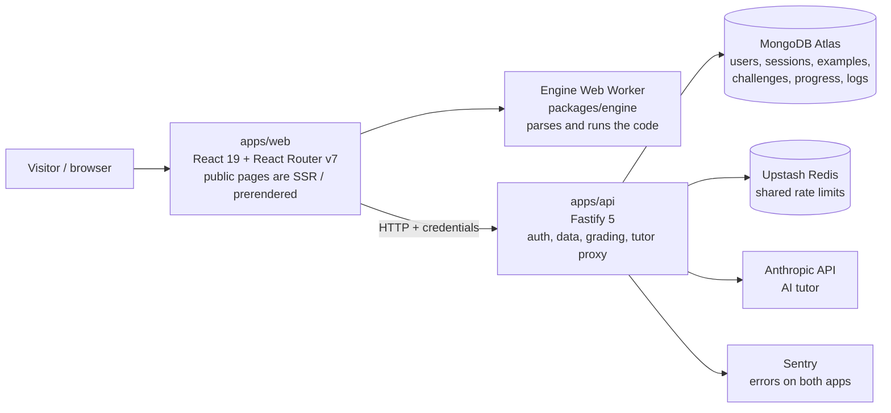

**Short version:** the code you write runs entirely in your browser on a sandboxed interpreter; the server is only involved for accounts, saved work, challenges, and the AI tutor.

---

## 2. A visitor's first five minutes

This is the growth path: public content is crawlable and free to read, the playground is open to everyone, and the account ask only appears when someone wants more.

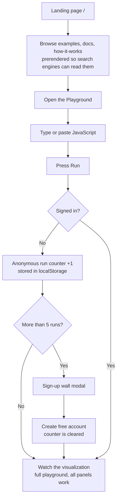

**Features in this flow:** public example library, docs and how-it-works pages, the playground, and the 5-free-run funnel. Everything stays visible — the wall is a modal, never a redirect.

---

## 3. Pressing Run: where the code actually goes

This is the heart of the product. The engine turns text into a typed event stream, and the UI simply plays that stream back — which is why scrubbing is instant and why it can run safely on the server too.

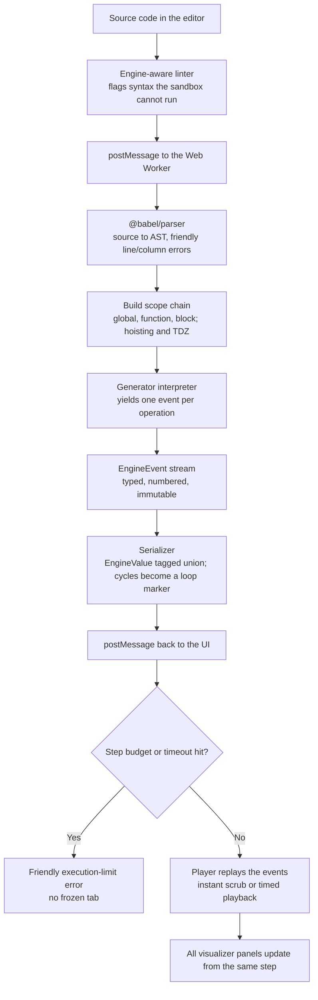

**Why this design matters:** one event array drives the highlight, the scope tree, the call stack, the graph, and the log — so they can never disagree with each other. The same pure interpreter grades challenge submissions on the server, because it has no access to `window`, `fetch`, `eval`, or `Function`.

---

## 4. Stepping, breakpoints, and live state

Because the interpreter is a suspendable generator, "step" and "breakpoint" are real execution control, not a replay trick.

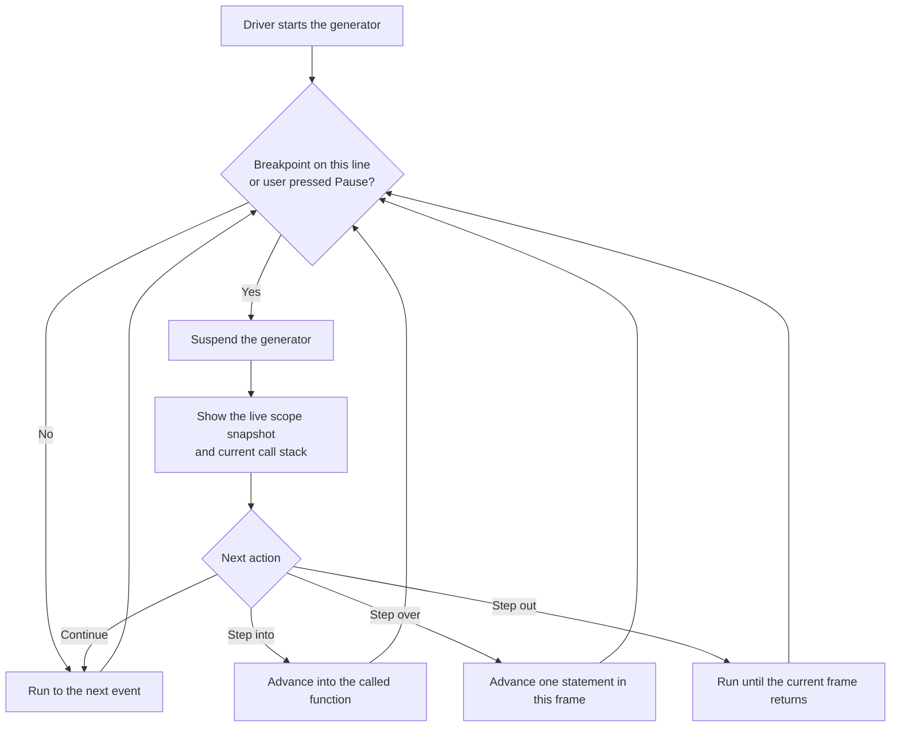

**Features in this flow:** gutter breakpoints, step into / over / out, pause and continue, speed control, and `Ctrl/Cmd+Enter`, `F10`, `F11`, `Shift+F11` shortcuts.

---

## 5. What each panel shows

Every panel is a different lens on the same current step.

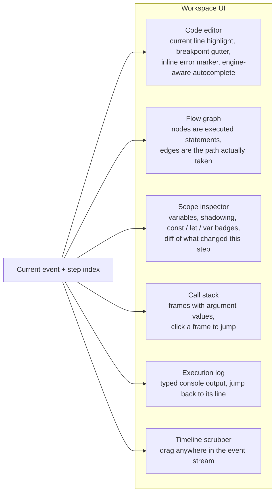

**Short version:** editor, visualizer, and log are the three main columns; the scope inspector and call stack are supporting panels; the timeline ties them all together.

---

## 6. Signing in and staying signed in

Account state is deliberately split: a short-lived access token lives in memory, a long-lived refresh token lives in a cookie, and a refresh happens automatically when access expires.

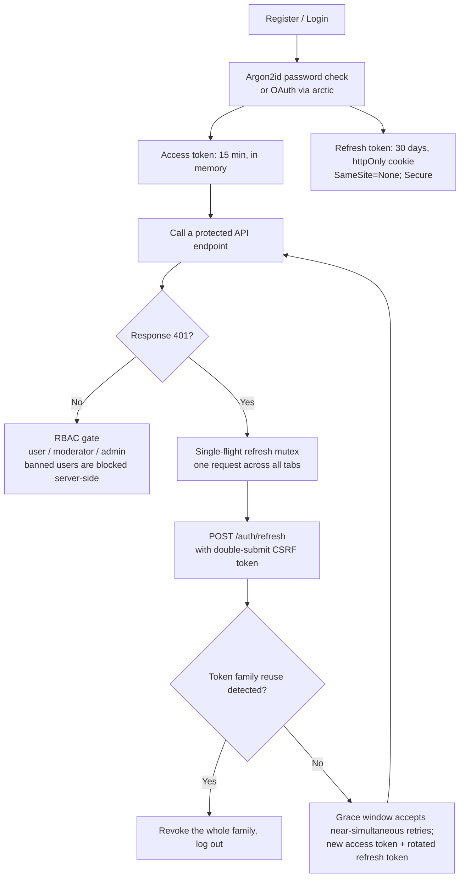

**Features in this flow:** own-the-session auth, rotating refresh tokens, reuse detection, ban enforcement, RBAC, CSRF protection, and shared-store rate limits.

---

## 7. Saving and sharing your work

A save is a real record; a share is just a link. Anonymous users can still share, because sharing is how a first-time visitor brings a friend in without hitting the wall.

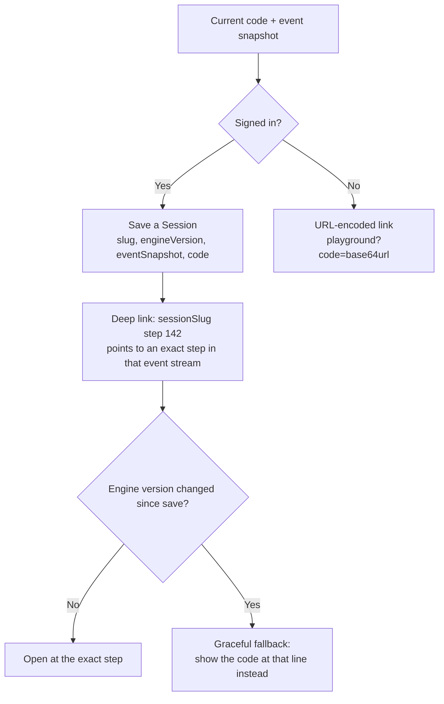

**Features in this flow:** saved sessions, forks, public/private toggles, deep links to a step, and anonymous code sharing.

---

## 8. Challenges, XP, and the leaderboard

Grading uses the same sandboxed engine as the playground, but on the server, where it is bounded by a step budget and timeout.

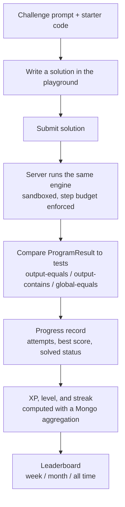

**Features in this flow:** challenge CRUD, grading contract, hints, XP and levels, streaks, public profile, and the leaderboard. Account-only, because progress has to belong to someone.

---

## 9. The AI tutor

The tutor never sees the whole file or any secret. It is fed the exact state on screen, so its answers stay grounded in what you are actually looking at.

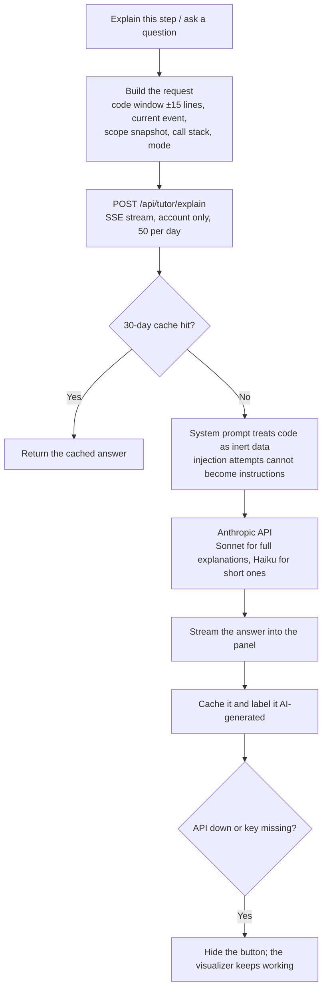

**Features in this flow:** step explanation, free-text questions, "why is this wrong?" on errors, quiz mode, streaming responses, AI-generated disclaimer, and a graceful fallback.

---

## 10. Content, admin, and support

Everything the public sees is authored or moderated here, and every privileged action leaves a trace.

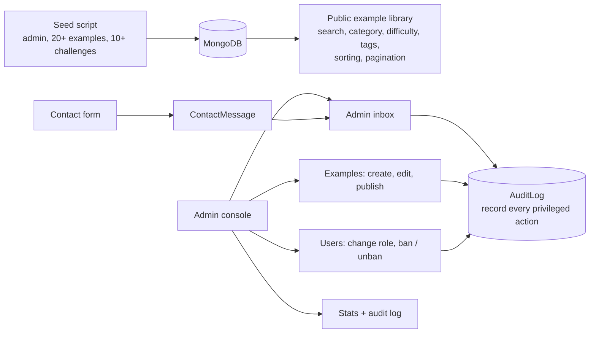

**Features in this flow:** real contact pipeline, admin console, moderation, analytics, and audit trail.

---

## 11. One codebase, two environments

The same engine code runs in the browser worker and on the server. Local development and deployment differ only in wiring and environment variables.

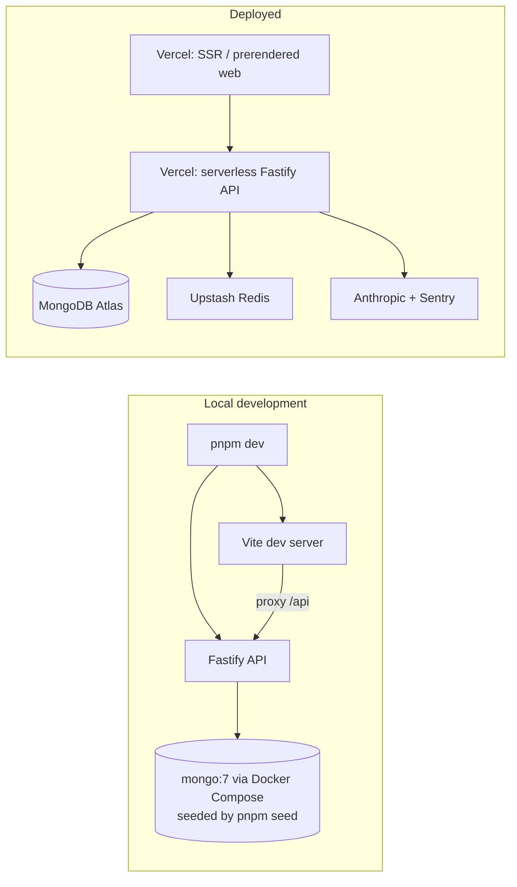

**Short version:** no hand-written `index.html`, no secret fallbacks, and the database credentials are rotated at the database level before anything ships.

---

## 12. Feature quick reference

| Feature | What it does | Flow |
|---|---|---|
| Public pages | Landing, examples, docs, how-it-works — prerendered so they can be found and read | 2 |
| Playground | Write code and watch what it does, step by step | 2, 3 |
| Sandboxed engine | Parses and interprets JavaScript without touching the browser or Node host | 3 |
| Event stream | One typed, replayable record of every operation | 3, 5 |
| Timeline + speed | Scrub or watch the execution at different speeds | 4, 5 |
| Breakpoints + stepping | Pause real execution and inspect live state | 4 |
| Scope inspector / call stack | See variables, shadowing, and function frames | 5 |
| Flow graph | See the path the program actually took | 5 |
| 5-run wall | Anonymous taste of the product, then an account ask | 2, 6 |
| Own-the-session auth | Tokens, refresh rotation, RBAC, bans, CSRF | 6 |
| Saved sessions + sharing | Keep runs, fork them, link to an exact step, share without an account | 7 |
| Challenges + progression | Grade solutions, earn XP, keep streaks, climb the leaderboard | 8 |
| AI tutor | Explain the step you are on, grounded in the engine's own state | 9 |
| Admin + contact | Moderate content and users, answer messages, audit privileged actions | 10 |
| PWA + offline | The app keeps working after the first load | 11 |

---

## 13. Where this sits in the build plan

| Flow above | Built in |
|---|---|
| 1, 11 | Phase 0 (foundation) and Phase 4 (backend v2) |
| 2, 5 | Phase 3 (UI/UX rebuild) |
| 3, 4 | Phase 2 (the engine) — the highest-value phase |
| 6 | Phase 4 (backend v2) |
| 7, 8, 10 | Phase 5 (product depth) |
| 9 | Phase 6 (the AI tutor) |

The product is genuinely usable at Phase 4; Phases 5–7 add the depth that makes it a portfolio piece rather than a demo.
